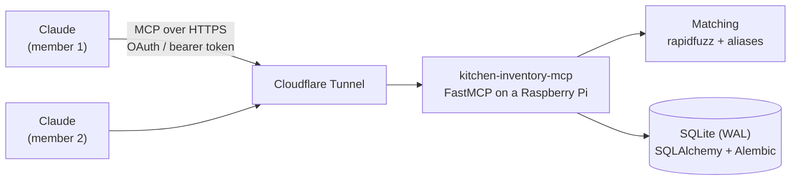

# kitchen-inventory-mcp

An MCP server that gives Claude a memory of what's in the pantry, fridge and freezer. Add stock by pasting a grocery order or sending a photo, ask what's for dinner, and the server works out which recipes the kitchen can actually make. Log the meal and the ingredients come out of inventory. I built it because asking an assistant "what can I cook tonight?" is only useful if it knows what's really on hand, and keeping that list current by hand never lasts. Two adults use it at once from their own Claude clients (desktop and phone), and household preferences such as a child's dislikes feed into planning.

**The design rule: the server keeps the books and the model does the thinking.** The server never calls an LLM. Claude reads photos, invents recipes and reasons about substitutions. The server stores state and does the deterministic parts: fuzzy matching to canonical items, duplicate detection, recipe coverage scoring, and first-expiring-first-out depletion.

## Architecture



## Tools

| Area | Tools |
|---|---|
| Inventory | `add_inventory_items`, `get_inventory`, `update_inventory_item`, `remove_inventory_item`, `get_item_history`, `sweep_expired` |
| Duplicates | `resolve_duplicate`, `resolve_order_batch` |
| Planning | `get_planning_context`, `score_recipe_coverage`, `suggest_groceries`, `dismiss_grocery_suggestion` |
| Recipes and meals | `save_recipe`, `update_recipe`, `delete_recipe`, `rate_recipe`, `get_recipe_history`, `log_meal`, `undo_meal_log` |
| Preferences | `get_preferences`, `set_preference`, `remove_preference` |

## Example

> **Me:** *(pastes a grocery delivery confirmation)* Add this order.
>
> **Claude** *(calls `add_inventory_items` with an `order_dedup_key` taken from the order number)*: Added 14 items. "Roma tomatoes" matched your existing *tomato* item. "Everything bagel seasoning" is new, so I created it as a staple. Nothing was flagged as a duplicate.
>
> **Me:** What can we make tonight that uses the spinach before it goes off?
>
> **Claude** *(calls `get_planning_context`, then `score_recipe_coverage` on two ideas)*: The spinach expires Thursday. A spinach and chickpea curry scores 100%: you have everything. A frittata only scores partial on eggs, because you don't have enough.
>
> **Me:** Curry it is. We made 4 servings.
>
> **Claude** *(calls `save_recipe`, then `log_meal`)*: Logged. The spinach and one can of chickpeas came out of inventory, and the coconut milk is now marked open.

## Requirements

- Python 3.11+
- [uv](https://docs.astral.sh/uv/)
- `sqlite3` CLI (for backups)

## Local setup

```bash
uv sync
```

Copy the env template and fill in a real token:

```bash
cp .env.example .env
# generate a token:
python3 -c "import secrets; print(secrets.token_urlsafe(32))"
# put it in .env as KITCHEN_MCP_TOKEN=...
```

Apply migrations and seed the starter canonical-item list (~100 common
items and aliases):

```bash
export KITCHEN_MCP_DB_PATH=~/kitchen-inventory-data/kitchen.db
uv run alembic upgrade head
uv run python scripts/seed_canonical_items.py
```

Run the server:

```bash
export KITCHEN_MCP_TOKEN=<your token>
uv run python -m kitchen_inventory_mcp
```

It listens on `127.0.0.1:8811` by default (`KITCHEN_MCP_HOST` /
`KITCHEN_MCP_PORT` to change), serving MCP over streamable HTTP at `/mcp`
and an unauthenticated `GET /health` (status + version only, no inventory
data -- used for Cloudflare Tunnel health checks).

## Environment variables

| Variable | Required | Default | Purpose |
|---|---|---|---|
| `KITCHEN_MCP_TOKEN` | yes | none | Shared bearer token. Server refuses to start without it. Never commit this. |
| `KITCHEN_MCP_DB_PATH` | no | `~/kitchen-inventory-data/kitchen.db` | SQLite file path. |
| `KITCHEN_MCP_LOG_PATH` | no | `~/kitchen-inventory-data/auth.log` | Auth-failure log (timestamp + source IP only, never the token). |
| `KITCHEN_MCP_HOST` | no | `127.0.0.1` | Bind host (keep it local behind a tunnel). |
| `KITCHEN_MCP_PORT` | no | `8811` | Bind port. |
| `KITCHEN_MCP_PLANNING_RECIPE_LIMIT` | no | `40` | Default cap on `get_planning_context`'s recipe payload. |
| `KITCHEN_MCP_BACKUP_DIR` | no | `<db dir>/backups` | Where `scripts/backup.sh` writes. |
| `KITCHEN_MCP_PUBLIC_URL` | only for OAuth | none | The server's public HTTPS URL (e.g. `https://kitchen.example.com`), no trailing slash. Required for the `/oauth/*` and `/.well-known/*` endpoints below -- the server sits behind a reverse tunnel and can't infer its own public URL from the request. |

`.env.example` documents these with empty values. `.gitignore` excludes
`.env`. Tokens are compared with `hmac.compare_digest`, never `==`.

## Connecting Claude

There are two ways to authenticate, depending on which Claude app you're using:

**Local config with a custom header** (Claude Desktop's `mcpServers` config,
or any MCP client that supports custom headers) -- works on any device that can run
a local process, since a small bridge (e.g. the `mcp-remote` npm package)
attaches the bearer token to the request itself:

```json
{
  "mcpServers": {
    "kitchen-inventory": {
      "command": "npx",
      "args": [
        "-y", "mcp-remote",
        "https://your-subdomain/mcp",
        "--header", "Authorization:Bearer ${KITCHEN_MCP_TOKEN}"
      ],
      "env": { "KITCHEN_MCP_TOKEN": "<your token>" }
    }
  }
}
```

**claude.ai's account-level custom connector** (web, mobile, and Desktop's
GUI connector dialog) -- this flow is tied to your account rather than a
device, so it's the only way to reach the server from a phone. It's built
around OAuth, not a raw header field, which is what `/oauth/*` and
`/.well-known/*` exist for (see `oauth.py`'s module docstring): a minimal
OAuth 2.1 + PKCE wrapper with no separate user/password system underneath
-- `/oauth/authorize` just checks the same `KITCHEN_MCP_TOKEN` and, on a
match, issues an access token to whichever client dynamically registered.
Deliberately out of scope: refresh tokens (access tokens expire after 30
days and the client just re-runs the authorize flow) and a full
consent/anti-phishing screen.

To use it: add a custom connector pointed at `https://your-subdomain/mcp`,
leave OAuth Client ID/Secret blank (dynamic registration handles this), and
when prompted, enter the same shared `KITCHEN_MCP_TOKEN`. Do this once per
device/account -- each household member's phone goes through the flow
independently, entering the same shared token. Requires
`KITCHEN_MCP_PUBLIC_URL` to be set on the server.

## Raspberry Pi deployment

1. Copy the repo to the Pi (or `git clone`), `uv sync` there.
2. Put the SQLite file on a USB SSD, not the SD card -- SD cards fail under
   sustained write load. Point `KITCHEN_MCP_DB_PATH` at the mounted drive.
3. Run the server under a process supervisor (systemd unit or similar) so
   it restarts on boot/crash. `python -m kitchen_inventory_mcp` reads all
   config from the environment, so the unit file just needs the env vars
   above set.
4. Cloudflare Tunnel: point a subdomain at `http://localhost:8811`, with
   the tunnel's health check hitting `/health` (unauthenticated by design).
5. Backup cron (nightly at 3:10am), using WAL-safe `sqlite3 .backup`,
   keeping the last 14:

   ```
   10 3 * * * KITCHEN_MCP_DB_PATH=/path/to/kitchen.db /path/to/kitchen-inventory-mcp/scripts/backup.sh >> /path/to/kitchen-inventory-data/backup.log 2>&1
   ```

6. Point a Claude client at the tunnel's MCP URL (`https://your-subdomain/mcp`)
   with the bearer token configured as the connector's auth header.

## Migrations

Alembic is set up from day one; the schema will change.

```bash
uv run alembic revision --autogenerate -m "description"
uv run alembic upgrade head
```

`tests/test_migrations.py` runs a real `alembic upgrade head` against a
throwaway DB and diffs the result against the SQLAlchemy models, so
migrations can't silently drift from `models.py` the way they could if
tests only ever used `Base.metadata.create_all`.

## Tests

```bash
uv run pytest
```

Coverage focuses on the places bugs would be genuinely costly: depletion
math (FEFO across multiple pantry rows for the same canonical item,
fractional-scale rounding, staple transitions, the negative-quantity guard,
`force=true` clamping, `undo_meal_log`), matching bands (exact alias,
auto-alias >=90, ambiguous 75-89, no false-merge on genuinely different
items), duplicate resolution (soft-delete only -- `item_history` never
orphans -- plus whole-batch order-replay resolution), the migration/model
drift check, the `/health` auth bypass, the planning-context recipe cap,
and the full OAuth handshake (registration, wrong-token rejection, PKCE
verification, single-use codes, the issued access token working against
`/mcp`).

## The item model

Two classes, set once on the canonical item (not per pantry row):

- **Countables** (cans, jars, eggs, chicken breasts): integer count.
  `log_meal` decrements by whole container units,
  **FEFO** -- earliest `expiration_date` first, nulls last, ties broken by
  `added_at`. A single ingredient's decrement can span multiple pantry rows
  if the same canonical item is split across several purchases/expiration
  dates; each affected row gets its own `item_history` entry.
- **Staples** (rice, flour, oil, salt, spices, milk, sugar): tracked by
  state (`full -> open -> low -> out`), not count. `log_meal` only ever
  moves `full -> open`; only a human moves it further via
  `update_inventory_item`. A staple at `open` or `low` never blocks a
  recipe from being suggested.

## Duplicate detection (three independent mechanisms)

1. **Within-batch collisions** (two lines for the same purchase in one
   photo/paste): the calling client is expected to collapse these itself
   before calling `add_inventory_items` -- see that tool's description. As
   a deterministic backstop, byte-identical lines (same name, quantity/
   state, unit, container_size, location, expiration_date) that still slip
   through get silently summed into one row. Any difference in even one of
   those fields is treated as genuinely separate stock, no flag.
2. **Cross-call order replay** (the same order pasted twice, possibly
   hours apart): pass a client-computed `order_dedup_key` (prefer the
   order/confirmation number if visible, else a normalized-text hash) to
   `add_inventory_items`. A repeat within 30 days flags the whole batch
   `possible_duplicate` / `order_replay`. Resolve the *entire* batch in one
   call with `resolve_order_batch(order_batch_id, action)` --
   `discard` or `keep_separate` -- instead of one `resolve_duplicate` call
   per row.
3. **Fuzzy name ambiguity** (75-89 `rapidfuzz` token-set score against
   existing aliases/canonical names) and **physical-stock proximity**
   (same canonical item, same location, same expiration/container
   metadata, added within 15 minutes) each independently flag
   `possible_duplicate` with a `review_reason` of `alias_confidence` or
   `possible_stock_duplicate`. Resolve per-row with
   `resolve_duplicate(pantry_item_id, action, target_item_id?)` --
   `merge` / `keep_separate` / `discard`.

`resolve_duplicate` and `resolve_order_batch` never hard-delete: the
losing row is soft-deleted (`removed_at` set, quantity zeroed / state set
to `out`, `superseded_by` pointing at the row it merged into when
applicable) and a compensating `item_history` row is written, so
`item_history.pantry_item_id` never orphans.

## Worked example, tool by tool: paste an order, cook, see inventory drop

1. **Paste a grocery order.** Claude reads the confirmation email/text you
   paste, extracts structured items, and calls
   `add_inventory_items(items=[...], actor="sam", source="order_import",
   confidence=1.0, order_dedup_key="<order id or a hash of the text>")`.
   Items resolve against the seeded canonical items; anything ambiguous
   comes back flagged for review.
2. **Ask what's for dinner.** Claude calls `get_planning_context()` to see
   current inventory, what's expiring soon, household preferences, and
   recently-cooked meals, then invents a recipe idea and grades it with
   `score_recipe_coverage(ingredients=[...])`.
3. **Tweak it**, then `save_recipe(recipe={...}, ingredients=[...],
   actor="sam")`. If you change your mind later, `update_recipe` edits
   it in place (renaming is just setting the `name` field); `delete_recipe`
   archives it without breaking past `meal_log` history.
4. **Rate it** after eating: `rate_recipe(recipe_id, rater="alex", rating=5)`
   and separately `rate_recipe(recipe_id, rater="sam", rating=3)` --
   disagreement between the two of you is signal worth keeping.
5. **Log the meal**: `log_meal(recipe_id, servings_made=6, cooked_by="sam")`.
   If depletion would take anything negative, the whole call aborts with a
   `shortfalls` list and inventory is untouched; re-run with `force=true`
   to proceed anyway (clamped items are reported).
6. **Check inventory**: `get_inventory()` shows the countables decremented
   (oldest-expiring stock first) and any staple that was still sealed now
   at `open`. Fat-fingered `servings_made`? `undo_meal_log(meal_log_id)`
   reverses it exactly.
